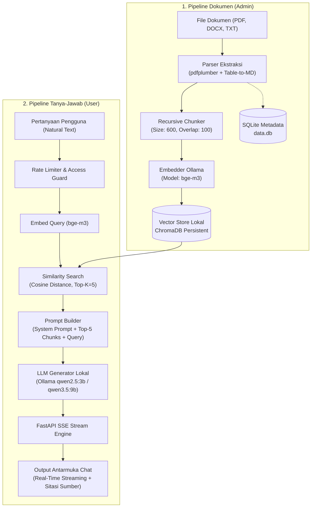

# 📐 Rancangan Sistem: Chatbot RAG Ekstraksi Data Dokumen Internal

Dokumen ini berisi spesifikasi teknis dan rancangan arsitektur lengkap untuk **Sistem Chatbot Berbasis Retrieval-Augmented Generation (RAG)** yang mengekstrak dan menjawab pertanyaan dari dokumen internal (PDF, DOCX, TXT) secara **100% lokal** (*Zero Data Leak*).

---

## 1. 📌 Pendahuluan & Ringkasan Sistem

### 1.1 Latar Belakang & Masalah
Institusi dan organisasi sering kali mengelola tumpukan dokumen internal (laporan teknis, berkas Tugas Akhir, SOP, panduan regulasi, dan arsip) yang tebal. Pencarian informasi konvensional menggunakan **Ctrl + F** atau pembacaan manual memiliki kelemahan:
- Hanya mencocokkan kata kunci eksak (*exact match*), gagal mengenali sinonim atau konteks makna.
- Sulit memproses data yang terstruktur dalam bentuk tabel.
- Membutuhkan waktu lama dan beban kognitif tinggi bagi pengguna.

### 1.2 Solusi Sistem
Sistem ini memadukan **AI Generatif (LLM)** dengan teknik **Retrieval-Augmented Generation (RAG)** berbasis model lokal (Ollama):
- **100% Lokal (Zero Data Leak):** Tidak ada dokumen, potongan teks, atau query yang dikirim ke cloud / API pihak ketiga.
- **Ekstraksi Tabel Cerdas (*Table-to-Markdown*):** Mengonversi tabel PDF menjadi format Markdown (`| Kolom |`) agar konteks struktural tetap presisi.
- **Streaming Response Real-Time:** Menampilkan jawaban kata per kata (*typewriter effect*) via Server-Sent Events (SSE).
- **Sitasi Sumber Referensi:** Setiap jawaban dilengkapi sumber dokumen, nomor halaman asal, dan skor kemiripan (*similarity distance*).

---

## 2. 🏗️ Arsitektur Sistem (System Architecture)

Sistem dibagi menjadi 2 subsistem utama: **Pipeline Ingest Dokumen (Admin)** dan **Pipeline Tanya-Jawab (User)**.



---

## 3. 🛠️ Spesifikasi Tech Stack

| Komponen | Teknologi | Peran & Alasan Pemilihan |
| :--- | :--- | :--- |
| **Backend Framework** | **FastAPI** (Python 3.11 / 3.12) | REST API & Server-Sent Events (SSE) streaming yang cepat dan *asynchronous*. |
| **Server Runner** | **Uvicorn** | ASGI server performa tinggi untuk FastAPI. |
| **AI Inference Engine**| **Ollama** (Lokal) | Menjalankan LLM & Embedding model secara offline tanpa ketergantungan API luar. |
| **LLM Model** | **`qwen2.5:3b`** / **`qwen3.5:9b`** | Model bahasa alami berdaya nalar tinggi dengan dukungan Bahasa Indonesia yang sangat baik. |
| **Embedding Model** | **`bge-m3`** (via Ollama) | Embedding model multibahasa 1024-dimensi berakurasi tinggi untuk *semantic search*. |
| **Vector Database** | **ChromaDB** (Persistent embedded) | Penyimpanan vektor HNSW lokal di `./chroma_db`, tanpa memerlukan server terpisah. |
| **Relational Database**| **SQLite** (`data.db`) | Penyimpanan metadata dokumen yang diunggah dan akun otentikasi admin. |
| **Document Parser** | `pdfplumber`, `python-docx` | Ekstraksi teks & pemrosesan grid tabel PDF menjadi format Markdown. |
| **Frontend UI** | **Vanilla HTML5, CSS3, Modern JS** | Tampilan modern responsif, tanpa build-step / Node.js dependency. |

---

## 4. 🗄️ Rancangan Basis Data (Database Design)

Sistem menggunakan 2 jenis basis data terpisah sesuai peruntukannya:

### 4.1 SQLite Relational Database (`data.db`)

#### Tabel `documents` (Metadata Dokumen)
| Kolom | Tipe Data | Keterangan |
| :--- | :--- | :--- |
| `id` | `TEXT PRIMARY KEY` | UUID unik dokumen |
| `name` | `TEXT NOT NULL` | Nama file asli (contoh: `SOP_Keuangan.pdf`) |
| `file_path` | `TEXT NOT NULL` | Path fisik penyimpanan file di `./uploaded_docs` |
| `upload_date` | `TEXT NOT NULL` | Stempel waktu ISO-8601 upload |
| `chunk_count` | `INTEGER NOT NULL` | Jumlah potongan teks (*chunks*) yang diindeks |

#### Tabel `admins` (Manajemen Pengguna Admin)
| Kolom | Tipe Data | Keterangan |
| :--- | :--- | :--- |
| `id` | `INTEGER PRIMARY KEY AUTOINCREMENT` | ID pengguna |
| `username` | `TEXT UNIQUE NOT NULL` | Username login admin |
| `password_hash` | `TEXT NOT NULL` | Hash password terenkripsi (`bcrypt`) |
| `role` | `TEXT NOT NULL DEFAULT 'admin'` | Hak akses (`superadmin` / `admin`) |
| `created_at` | `TEXT NOT NULL` | Stempel waktu pembuatan akun |

---

### 4.2 Vector Database (ChromaDB Persistent)
- **Nama Collection:** `rag_documents`
- **Metrik Jarak:** Cosine Distance (`hnsw:space: cosine`)
- **Struktur Dokumen Vektor:**
  - `id`: `{doc_id}__chunk_{chunk_index}`
  - `document` (page_content): Teks potongan dokumen
  - `embedding`: Vektor 1024-dimensi dari `bge-m3`
  - `metadata`: `{ "doc_id": str, "source": str, "page_num": int, "chunk_index": int }`

---

## 5. 🔄 Desain Pipeline RAG (RAG Core Engine)

### 5.1 Document Processing & Table Extraction (`rag/parser.py`)
- **PDF Parsing:** Menggunakan `pdfplumber`. Setiap halaman diinspeksi. Jika ditemukan tabel, garis grid diekstrak dan dikonversi menjadi string Markdown (`| Header 1 | Header 2 |`) agar relasi baris dan kolom tidak hilang.
- **DOCX Parsing:** Menggunakan `python-docx` untuk mengekstrak paragraf dan tabel ke teks terstruktur.
- **TXT Parsing:** Membaca teks mentah encoding UTF-8.

### 5.2 Dynamic Text Chunking (`rag/chunker.py`)
- Menggunakan **Recursive Character Text Splitting**:
  - `CHUNK_SIZE = 600` karakter.
  - `CHUNK_OVERLAP = 100` karakter (menjaga kesinambungan konteks antar-potongan).
  - Separator hierarkis: `["\n\n", "\n", ". ", " ", ""]`.

### 5.3 Embedding & Vector Indexing (`rag/embedder.py` & `rag/vectorstore.py`)
- Teks *chunk* diubah menjadi representasi vektor oleh model `bge-m3` via HTTP API Ollama (`/api/embeddings`).
- Vektor disimpan secara permanen ke direktori `./chroma_db`.

### 5.4 Vector Retrieval (`rag/retriever.py`)
- Pertanyaan pengguna di-embed menggunakan `bge-m3`.
- Dilakukan pencarian kemiripan kosinus untuk mengambil **Top-K (5 chunk)** dengan skor relevansi tertinggi.

### 5.5 Prompt Engineering & Context Guardrails (`rag/generator.py`)
Prompt yang diinjeksikan ke LLM dirancang secara ketat untuk mengunci jawaban berbasis dokumen:

```text
Anda adalah asisten AI yang membantu menjawab pertanyaan berdasarkan dokumen internal.
Tugas Anda adalah memberikan jawaban yang akurat, jelas, dan hanya berdasarkan konteks yang diberikan.

KONTEKS DOKUMEN:
---
[Sumber: SOP_Keuangan.pdf | Halaman: 3]
... isi chunk 1 ...

[Sumber: SOP_Keuangan.pdf | Halaman: 4]
... isi chunk 2 ...
---

ATURAN PENTING:
1. Jawab pertanyaan HANYA berdasarkan konteks dokumen di atas.
2. Jika jawaban TIDAK ADA dalam konteks, katakan secara jujur: "Maaf, informasi tersebut tidak ditemukan dalam dokumen yang tersedia."
3. DILARANG berasumsi, mengarang, atau menggunakan pengetahuan di luar konteks dokumen.
4. Gunakan Bahasa Indonesia yang sopan dan mudah dipahami.

PERTANYAAN: {query}
JAWABAN:
```

### 5.6 Streaming Engine via SSE (`backend/chat_routes.py`)
Respons dikirimkan ke antarmuka pengguna dalam bentuk aliran event SSE real-time:
1. `event: status` $\rightarrow$ Menyampaikan status eksekusi (`retrieving`, `generating`).
2. `event: sources` $\rightarrow$ Mengirim metadata sumber sitasi (`source`, `page_num`, `distance`).
3. `event: token` $\rightarrow$ Mengalirkan potongan kata jawaban dari LLM.
4. `event: done` $\rightarrow$ Menyampaikan ringkasan eksekusi akhir.

---

## 6. 🌐 Desain REST API & Endpoints

| Endpoint | Method | Hak Akses | Deskripsi |
| :--- | :--- | :--- | :--- |
| `/api/auth/login` | `POST` | Publik | Autentikasi admin, mengembalikan token sesi cookie |
| `/api/auth/logout` | `POST` | Admin | Menghapus sesi login admin |
| `/api/auth/me` | `GET` | Admin | Memeriksa informasi profil admin yang sedang login |
| `/api/documents` | `GET` | Publik | Mengambil daftar dokumen yang terindeks |
| `/api/documents/upload` | `POST` | Admin | Mengunggah dokumen baru (PDF, DOCX, TXT) & memicu indexing |
| `/api/documents/{doc_id}` | `DELETE` | Admin | Menghapus dokumen dari disk, SQLite, dan ChromaDB |
| `/api/chat/stream` | `POST` | Publik | Stream tanya-jawab RAG (Event-Stream SSE) |

---

## 7. 🛡️ Keamanan & Control Flow (Security Guardrails)

1. **Role-Based Access Control (RBAC):**
   - **User Chat:** Hak akses *Read-Only* ke endpoint percakapan tanpa login.
   - **Admin:** Membutuhkan autentikasi berbasis token cookie untuk akses upload, re-index, dan hapus dokumen.
   - **Super Admin:** Mengelola akun admin lain via skrip CLI [`setup_admin.py`](file:///e:/Coding/TA/setup_admin.py).
2. **Access Guard & Rate Limiting:**
   - Opsional PIN akses `CHAT_ACCESS_KEY` pada `.env`.
   - Rate limiter batas pertanyaan per menit berbasis IP (`RATE_LIMIT_CHAT_PER_MINUTE`).
3. **Pencegahan Halusinasi AI:**
   - System prompt guard ketat melarang spekulasi di luar dokumen.

---

## 8. 📂 Struktur Direktori Proyek

```text
TA/
├── backend/                  # REST API Routes & App Server
│   ├── auth_routes.py        # Sesi & login admin
│   ├── chat_routes.py        # Stream SSE tanya-jawab
│   ├── document_routes.py    # CRUD & upload dokumen
│   └── main.py               # Inisialisasi FastAPI & middleware
│
├── frontend/                 # Interface Pengguna & Admin
│   ├── index.html            # Antarmuka Chat User
│   ├── admin.html            # Dashboard Admin Dokumen
│   ├── css/                  # Custom Styling (Dark/Light mode)
│   └── js/                   # EventSource SSE client & UI handler
│
├── rag/                      # RAG Core Engine
│   ├── parser.py             # PDF (Table-to-MD), DOCX, TXT parser
│   ├── chunker.py            # Splitting rekursif (600/100)
│   ├── embedder.py           # Integration bge-m3 Ollama
│   ├── vectorstore.py        # ChromaDB persistent interface
│   ├── retriever.py          # Similarity search Top-K
│   ├── generator.py          # Generator prompt & streaming LLM
│   └── pipeline.py           # End-to-end orchestration
│
├── db/
│   └── database.py           # SQLite connection & CRUD logic
│
├── uploaded_docs/            # Penyimpanan fisik file asli
├── chroma_db/                # Penyimpanan basis data vektor ChromaDB
├── data.db                   # Database SQLite lokal (metadata & admin)
├── .env.example              # Template konfigurasi environment
├── config.py                 # Pemuat variabel konfigurasi global
├── setup_admin.py            # CLI helper manajemen admin
└── main.py                   # Entry point server Uvicorn
```
